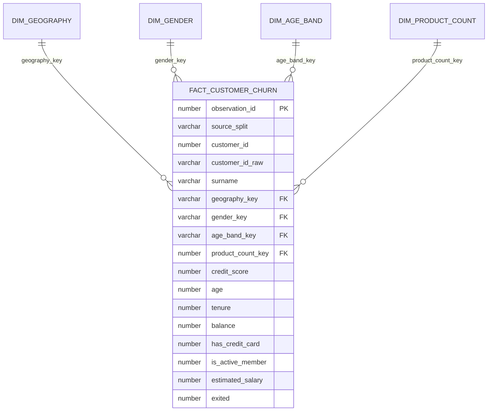
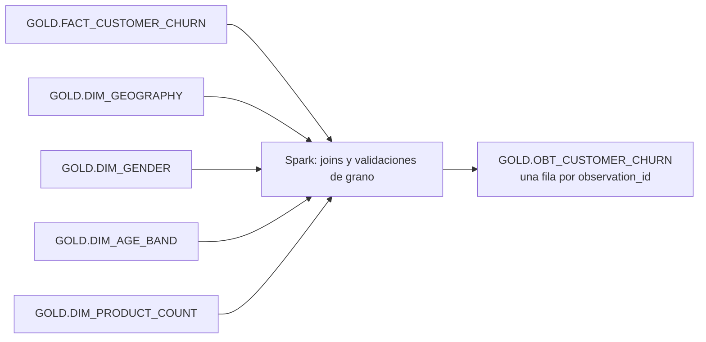

# PSet 2 — pasos 3 y 4

## Paso 3: calidad y limpieza

La evidencia se calculó directamente sobre los CSV entregados: 15.000 filas en `train.csv` y 10.000 en `test.csv`. Los campos vacíos fueron 0/15.000 y 0/10.000, respectivamente; los `id` también son únicos en cada archivo. Las comprobaciones de rango encontraron 0 valores fuera de rango para score de crédito (300–850), edad (18–100), tenure (0–10), balance no negativo, número de productos (1–4) y flags binarios.

| Problema | Evidencia | Acción en dbt | Justificación |
|---|---:|---|---|
| `CustomerId` no entero | 1 de 15.000 filas de train (0,0067%); `id=5597`, valor `156917.93`. Ninguno en test. | Silver deja `customer_id` en NULL, conserva `customer_id_raw` y marca `customer_id_is_valid = false`; no elimina la observación. | Un identificador fraccionario no es una clave de cliente utilizable. Conservar la fila protege el grano y permite auditar el dato fuente. |
| `CustomerId` repetido | 3.454 valores de `CustomerId` aparecen en más de una fila de train (8.777 filas adicionales respecto de una fila por ID repetido). | No se deduplica por `CustomerId`; se conserva `id` como clave de observación. | Las filas son observaciones del dataset, y los atributos de cliente no son consistentes entre repeticiones. No hay evidencia para elegir una fila “más reciente”. |
| Posible outlier de salario en test | 1 de 10.000 salarios supera el máximo observado en train (199.992,48); el valor es 1.318.052,04. | Se conserva y se reporta como `estimated_salary_above_train_max_review`; no se recorta ni elimina. | El máximo de train no es un límite de negocio ni hay fuente externa para probar que el valor sea erróneo. Se marca para investigación, no se “corrige” por suposición. |
| Exactitud frente a la realidad | No hay una fuente independiente para contrastar atributos del cliente. | Se valida formato, completitud, dominios y rangos plausibles; no se afirma exactitud externa. | Sin una referencia autoritativa no puede medirse la veracidad real de los valores. |

`bronze_train` y `bronze_test` convierten las columnas raw de texto a tipos numéricos con `TRY_TO_*`; los CSV originales siguen en `RAW`. En Silver se estandarizan país y género, se marca el `CustomerId` no entero y se conserva la separación entre train y test. `silver_quality_report` deja métricas reproducibles en Snowflake. Los tests de dbt comprueban claves, dominios y la correspondencia entre el indicador de validez y el valor limpio.

## Paso 4: Gold dimensional

**Grano de `fact_customer_churn`: una fila por `id` del dataset, tanto en train como en test.** `observation_id` es único; `source_split` preserva la procedencia y `exited` es NULL en test, ya que el CSV no contiene la etiqueta. No se usa `CustomerId` como clave de dimensión: se repite y tiene atributos contradictorios.



Las dimensiones tienen una fila por valor normalizado (geografía, género, bandas de edad 18–29/30–39/40–49/50+ y cantidad de productos). `id`, `CustomerId` y apellido se conservan en el hecho como identificadores descriptivos, no como una dimensión de cliente deduplicada. Los tests de `not_null`, `unique`, dominios y `relationships` verifican las claves y los joins.

## Ejecución

Desde la raíz, instala dbt en un entorno compatible con dbt-snowflake y exporta las variables de `.env` al proceso:

```bash
python3.12 -m venv .venv-dbt
source .venv-dbt/bin/activate
pip install -r dbt/requirements.txt
set -a
source .env
set +a
dbt debug --project-dir dbt --profiles-dir dbt
dbt build --project-dir dbt --profiles-dir dbt
```

Primero debe haberse ejecutado la ingesta de Kestra para que existan `RAW.TRAIN` y `RAW.TEST`. dbt crea las capas `BRONZE`, `SILVER` y `GOLD` en la base indicada por `SNOWFLAKE_DATABASE`.

## Paso 5: Spark y OBT

El job [`spark/build_obt.py`](../spark/build_obt.py) lee desde `GOLD` la tabla `FACT_CUSTOMER_CHURN` y las dimensiones `DIM_GEOGRAPHY`, `DIM_GENDER`, `DIM_AGE_BAND` y `DIM_PRODUCT_COUNT`. Spark hace joins left usando las claves del hecho y produce una fila denormalizada con nombres de geografía y género, banda y límites de edad, número de productos y atributos/medidas originales.

El **grano de la OBT** es una fila por `observation_id`, idéntico al de la tabla de hechos. Antes de escribir, el job falla si hay claves de dimensión duplicadas/nulas, claves sin correspondencia, IDs duplicados, diferencias en el total o conteos distintos por `source_split`; también valida que el target exista solo para train y que sus etiquetas sean binarias. La tabla se reemplaza solo después de pasar estas comprobaciones: `GOLD.OBT_CUSTOMER_CHURN`.



Se conserva el star schema para análisis exploratorio y BI: sus dimensiones permiten reutilización, navegación y agregaciones por atributos. La OBT se utiliza para preparar features o entrenar modelos de ciencia de datos, porque evita reconstruir joins en cada consumo. Mantener `source_split` y `exited` nulo en test evita confundir la predicción de test con etiquetas observadas.

Para ejecutarlo, configura en `.env` `SNOWFLAKE_PASSWORD`, `SNOWFLAKE_GOLD_SCHEMA=GOLD` y `SNOWFLAKE_OBT_TABLE=OBT_CUSTOMER_CHURN`, luego corre `docker compose --profile spark run --rm spark`. El servicio usa Apache Spark 3.5.8, Java 17 y el conector Snowflake Spark 3.1.3; Maven descarga el conector en la primera ejecución.
